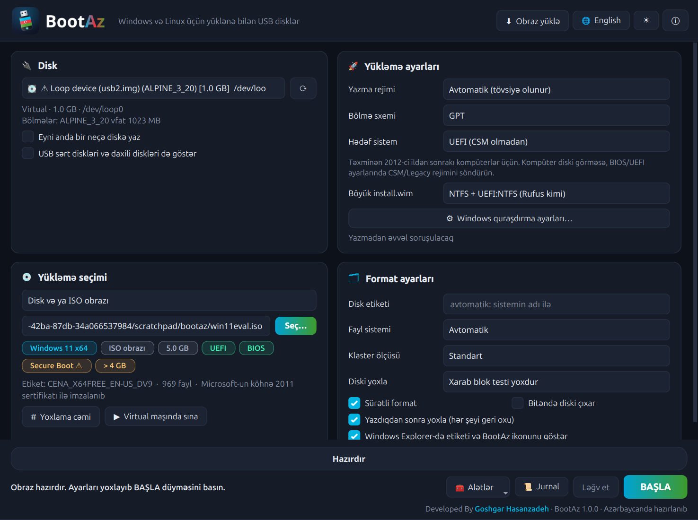
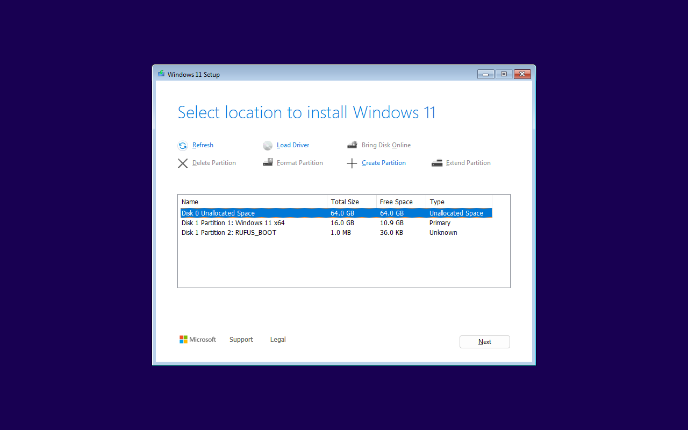
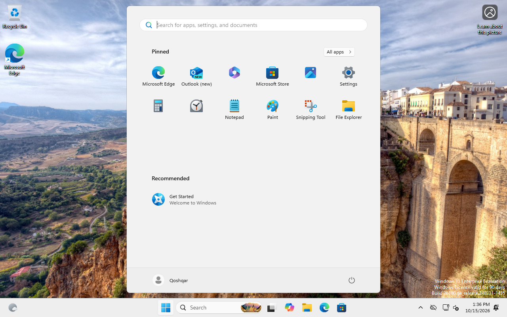

<p align="center"></p>

<p align="center"><b>Windows və Linux üçün yüklənə bilən USB disklər — Rufus kimi, amma həm Windows-da, həm də Linux-da</b><br>
<sub>Developed By <a href="https://goshgarhasanov.github.io">Goshgar Hasanzadeh</a> · Azərbaycanda hazırlanıb · GPL-3.0</sub></p>

<p align="center"></p>

**BootAz** ISO və disk obrazlarından yüklənə bilən USB fləş yaradan proqramdır. Rufus-un bütün əsas
funksiyaları var, üstəlik **Linux-da da işləyir**: Linux-dan Windows 11 quraşdırma fləşi yaratmaq
Rufus ilə mümkün deyil, BootAz ilə bir kliklə olur. İnterfeys tam **Azərbaycan** və **ingilis** dillərindədir.

| | Linux | Windows |
|---|---|---|
| Masaüstü proqram (GUI) | `./run_gui.sh` | `run_gui.bat` |
| Terminal (CLI) | `./run_cli.sh` | `run_cli.bat` |

Skriptlər ilk dəfə proyekti özü build edir. Linux-da `run_gui.sh` BootAz-ı proqram menyusuna da əlavə edir.
Diskə yazanda parol soruşulur (pkexec); Windows-da proqram administrator kimi açılır.

## Nə edə bilir

**Rufus-dakı hər şey**
- Disk siyahısı (USB fləş, SD kart; istəsəniz USB sərt disklər və daxili disklər), sistem diski heç vaxt yazılmır
- ISO / IMG obrazları: **ISO rejimi** (faylları köçürür, disk istifadəyə yararlı qalır) və **DD rejimi** (bayt-bayt)
- **GPT / MBR**, hədəf sistem **UEFI / BIOS / BIOS + UEFI**
- Fayl sistemi **FAT32, NTFS, exFAT, ext2/3/4**, klaster ölçüsü, disk etiketi, sürətli/tam format
- **4 GB-dan böyük FAT32** (Windows-un 32 GB limiti yoxdur — öz FAT32 formatlayıcısı)
- Windows ISO-ları: UEFI:NTFS (Secure Boot imzalı NTFS sürücüsü), BIOS üçün Windows MBR və boot record
- **Windows quraşdırma ayarları**: TPM 2.0 / Secure Boot / 4 GB RAM tələbini aradan qaldırmaq, Microsoft hesabı
  olmadan quraşdırma, lokal hesab, məxfilik suallarını ötürmək, BitLocker-i söndürmək, regional format, kompüter adı
- Linux üçün **persistence** (Ubuntu `writable` / `casper-rw`, Debian Live `persistence`)
- Syslinux və GRUB ilə ISO rejimində **BIOS yükləməsi**
- Xarab blok testi (1–4 keçid), MD5 / SHA-1 / SHA-256 / SHA-512, diski obraz kimi saxlamaq (img, VHD)
- Sıxılmış obrazlar: `.img.gz`, `.img.xz`, `.img.zst`, `.img.bz2`; sabit VHD

**Rufus-dan artıq olanlar**
- **Linux-da işləyir** — Linux-dan Windows 10/11 quraşdırma fləşi (sınaqdan keçib: aşağıya baxın)
- Böyük `install.wim` üçün **3 üsul**: NTFS + UEFI:NTFS, **FAT32 + NTFS (Microsoft üsulu)**, **FAT32 + bölünmüş WIM**
  (son ikisi yalnız FAT oxuyan noutbuklarda da işləyir)
- **Fləşin adı sistemə görə**: `WIN11 X64`, `UBUNTU_2604`, `ALPINE_3_20` — etiketə görə yüklənən Linux-lar üçün
  boot konfiqurasiyaları da avtomatik yenilənir
- **Saxta fləş aşkarlanması**: tam test (H2testw / F3 kimi) və **faylları silməyən 30 saniyəlik yoxlama** (ValiDrive kimi)
- **Yazdıqdan sonra yoxlama**: hər fayl (ISO rejimi) və ya hər bayt (DD rejimi) geri oxunub müqayisə olunur
- **Secure Boot xəbərdarlığı**: Windows yükləyicisi köhnə 2011 sertifikatı ilə imzalanıbsa (2024+ yeniləməli
  kompüterlərdə açılmaz) əvvəlcədən deyir
- **Eyni anda bir neçə fləşə yazmaq** (Etcher / Popsicle kimi)
- **Obraz yükləmə**: Ubuntu, Mint, Debian, Fedora, Kali, Arch, Alpine, Windows 11 Evaluation — rəsmi saytlardan,
  ən son versiya, SHA-256 yoxlaması ilə
- **Virtual maşında sınamaq** (QEMU) — yazmadan əvvəl obrazın açıldığını görmək
- **Fləşi bərpa etmək** — Rufus / Ventoy / dd-dən sonra fləşi yenidən tam həcmli adi diskə çevirmək
- Avtomatik checksum yoxlaması (`*.sha256`, `SHA256SUMS` yanında olarsa), sürüklə-burax, tünd / açıq mövzu
- Tam CLI: hər funksiya skriptlər üçün əmr kimi də var (JSON çıxışı ilə)

## Sınaqdan keçənlər

Hamısı loop cihazlarında yazılıb, QEMU-da USB fləş kimi yüklənib:

| Obraz | Rejim | Nəticə |
|---|---|---|
| Windows 11 Enterprise (5.4 GB, install.wim 4.6 GB) — **Linux-dan** | NTFS + UEFI:NTFS, MBR | ✅ UEFI və BIOS-da Setup açılır, TPM yoxlaması keçilir |
| Windows 11 | FAT32 + NTFS (iki bölmə), GPT | ✅ UEFI, **tam quraşdırma masaüstünə qədər**: lokal hesab "Qoshqar", Microsoft hesabı və məxfilik sualları olmadan, TPM-siz kompüterdə |
| Windows 11 | FAT32 + bölünmüş WIM, GPT | ✅ UEFI |
| Alpine 3.20 | DD | ✅ UEFI + BIOS |
| Alpine 3.20 | ISO, GPT, öz FAT32 | ✅ UEFI |
| Alpine 3.20 | ISO, MBR, Syslinux / GRUB | ✅ BIOS + UEFI |
| Windows CLI (`bootaz-cli.exe`, Wine altında) | analiz, ISO rejimi, hash | ✅ Linux ilə eyni nəticə |

<p align="center"> </p>
<p align="center"><sub>Solda: Linux-da yazılmış fləşdən Windows 11 Setup (TPM yoxlaması keçildi). Sağda: quraşdırma bitdi — lokal hesab, Microsoft hesabı olmadan.</sub></p>

## Terminal (CLI)

```
bootaz-cli                                   interaktiv köməkçi
bootaz-cli devices [--all]                   USB diskləri göstər
bootaz-cli analyze Win11.iso                 obrazın içində nə var və necə açılır
sudo bootaz-cli write --device /dev/sdb --image Win11.iso --win-bypass --win-no-online
sudo bootaz-cli write --device /dev/sdb --device /dev/sdc --image ubuntu.iso   (iki fləşə birdən)
sudo bootaz-cli format --device /dev/sdb --fs exfat --label FLESH
sudo bootaz-cli fakecheck --device /dev/sdb  saxta fləş yoxlaması (faylları silmir)
sudo bootaz-cli restore --device /dev/sdb    fləşi adi vəziyyətə qaytar
sudo bootaz-cli save --device /dev/sdb --out backup.img.zst
bootaz-cli hash ubuntu.iso                   SHA256SUMS ilə avtomatik müqayisə
```

Windows-da eyni əmrlər: `bootaz-cli write --device \\.\PhysicalDrive2 --image Win11.iso` (administrator əmr sətri).
`bootaz-cli help` bütün seçimləri göstərir; `--lang en` ingiliscə, `--json` skriptlər üçün.

## Build

**Linux (Ubuntu / Debian)**
```bash
sudo apt install build-essential cmake qt6-base-dev zlib1g-dev liblzma-dev libzstd-dev libbz2-dev \
                 dosfstools ntfs-3g exfatprogs e2fsprogs
# isteğe bağlı: syslinux grub-pc-bin wimtools qemu-system-x86 ovmf
cmake -S . -B build && cmake --build build -j
```

**Windows** — Qt 6 (MinGW) və CMake, "Qt 6 command prompt"-da:
```bat
cmake -S . -B build -G Ninja -DCMAKE_BUILD_TYPE=Release
cmake --build build
windeployqt build\BootAz.exe
```
Yalnız CLI-ı Linux-dan Windows üçün də build etmək olar: `cmake -S . -B build-win -DCMAKE_TOOLCHAIN_FILE=tools/mingw-toolchain.cmake -DBOOTAZ_GUI=OFF`.

**Testlər**: `tests/make_test_images.sh <qovluq>` nümunə obrazlar yaradır, sonra
`BOOTAZ_TEST_DATA=<qovluq> ctest --test-dir build` (nüvə, tərcümələr, GUI ↔ CLI). Real fləş testləri:
`sudo tests/integration.sh` (loop cihazları ilə), `tests/qemu_boot.sh` (QEMU-da yükləmə).

## Təhlükəsizlik

- Sistem diski (işləyən OS-un olduğu disk) heç vaxt yazılmır; daxili disklər yalnız açıq seçimlə göstərilir.
- Yazmadan əvvəl disk yenidən yoxlanılır (seriya nömrəsi / ölçü): fləş dəyişibsə, iş dayanır.
- Linux-da yalnız yazma işi administrator hüququ ilə işləyir (pkexec ilə `bootaz-cli`); GUI adi istifadəçidir.
- Obraz analizi və yükləmə administrator hüququ olmadan işləyir. Proqram heç bir məlumatı heç yerə göndərmir;
  internet yalnız "Obraz yüklə" pəncərəsində rəsmi saytlara müraciət üçün istifadə olunur.

Tam test, kod, təhlükəsizlik və gələcək review: [docs/REVIEW.md](docs/REVIEW.md).

## Lisenziya və təşəkkür

GPL-3.0. ms-sys yükləmə kodu və UEFI:NTFS sürücüləri [Rufus](https://github.com/pbatard/rufus) layihəsindən
(Pete Batard) götürülüb — ətraflı: [third_party/README.md](third_party/README.md).

---

## English

BootAz makes bootable USB drives from ISO and disk images — every core Rufus feature, on **Windows and Linux**,
in **Azerbaijani and English**. Extras over Rufus: Windows install media made from Linux, three layouts for
install.wim over 4 GB (NTFS + UEFI:NTFS, FAT32 + NTFS, split WIM), drive labels named after the system, full and
non-destructive fake-capacity checks, read-back verification, Secure Boot certificate warnings, writing several
drives at once, an official image downloader with SHA-256 checks, trying images in QEMU, and restoring drives.
Start with `./run_gui.sh` / `run_gui.bat`, or `./run_cli.sh help`.

Developed By **Goshgar Hasanzadeh** — https://goshgarhasanov.github.io

---

## Yükləmə / Download

Hazır proqram [GitHub Releases](https://github.com/goshgarhasanov/BootAz/releases/latest) səhifəsindədir
(ready-made builds are on the Releases page):

| | Fayl | Necə işə salmaq |
|---|---|---|
| **Windows 10 / 11** (GUI + CLI) | [BootAz-windows-x64.zip](https://github.com/goshgarhasanov/BootAz/releases/latest/download/BootAz-windows-x64.zip) | Arxivi açın, `BootAz.exe`-ni işə salın (administrator icazəsi soruşulur) |
| **Windows** — yalnız terminal | [bootaz-cli-windows-x64.exe](https://github.com/goshgarhasanov/BootAz/releases/latest/download/bootaz-cli-windows-x64.exe) | Tək fayl, quraşdırma lazım deyil; "Run as Administrator" terminalda |
| **Linux x86-64** (Ubuntu 24.04+) | [BootAz-linux-x64.tar.gz](https://github.com/goshgarhasanov/BootAz/releases/latest/download/BootAz-linux-x64.tar.gz) | `sudo apt install libqt6widgets6 qt6-qpa-plugins`, sonra `./BootAz` |

Hər buraxılışın yanında `SHA256SUMS` faylı var: `sha256sum -c SHA256SUMS`.
Windows faylları hələ rəqəmsal imzalı deyil, ona görə SmartScreen "Unknown publisher" xəbərdarlığı göstərə bilər.
